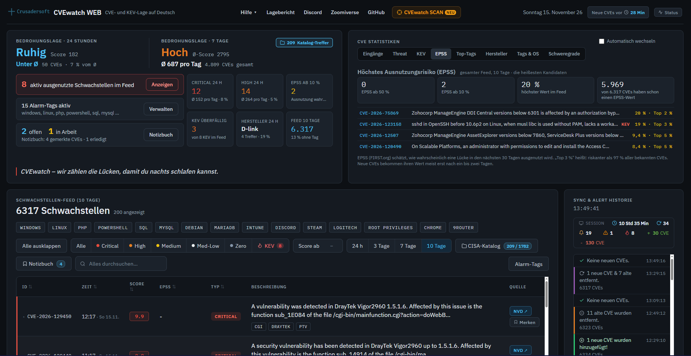
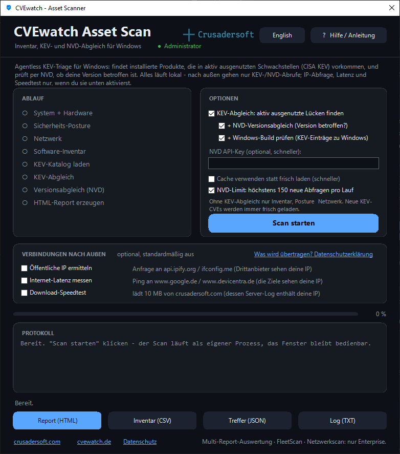

# CVEwatch

> Open security platform for vulnerability intelligence, Windows asset discovery and security posture assessment. Built in Germany by Crusadersoft.

🌐 [cvewatch.de](https://cvewatch.de) · 💬 [Discord](https://discord.gg/jKXJYyum3P) · ✉️ [support@crusadersoft.com](mailto:support@crusadersoft.com)

---

## The CVEwatch family

| Product | What it is | Status |
|---|---|---|
| **[CVEwatch WEB](#cvewatch-web)** | Live dashboard for the CVE and KEV situation in German: new vulnerabilities of the last 10 days, actively exploited flaws, the assessment of the German BSI and the CVE Program record (MITRE). No account, no telemetry. | Open Access · [cvewatch.de](https://cvewatch.de) |
| **[CVEwatch SCAN](#cvewatch-scan)** | One PowerShell script that checks a Windows device against the CISA KEV catalog, validates hits against NVD version ranges and assesses the security posture. This repository. | Open Source · Apache 2.0 |
| **[LUMO](#lumo)** | The CVEwatch AI. Runs locally on its own VM and translates CVE descriptions and remediation into German. | Phase 1 live |
| **[Enterprise](#enterprise-edition)** | Custom integration: fleet analytics, central dashboard, network discovery – fine-tuned for your environment in 2–4 weeks. | On request |

---

## CVEwatch WEB



**The CVE and KEV situation in German.** CVEwatch WEB merges five public sources and rates every CVE by severity *and* real-world exploitation – so the top of the dashboard always shows what actually matters today.

- 🎯 **Top risk:** the most dangerous CVE in the feed, weighted by active exploitation, BSI rating, score and EPSS
- 📊 **Situation card:** threat level for 24 h and 7 days, actively exploited CVEs, new BSI advisories, nine key figures
- 🔥 **KEV:** match against the CISA catalog, including ransomware use and CISA's required action
- 🇩🇪 **BSI:** German assessment by BSI CERT-Bund (WID) with rating and attack description
- 🧾 **CVE Program:** the vendor's record straight from MITRE – score (often CVSS 4.0), affected products, CWE, CISA's SSVC assessment
- 🔔 **Alerts:** your own feed tags, plus alerts that always fire: newly exploited (KEV), new BSI advisory rated "high" or above, KEV watchlist hits
- 🗂️ **Filters:** time range, severity, KEV, BSI, minimum score, weakness type, tags, full text – freely combinable
- 📓 **Notebook:** track CVEs with status and notes – stays local, saved and restored as a file
- 📄 **Reports:** 24-hour and 7-day report as PDF, CSV export, Discord broadcast

**Scoring:** NVD, the vendor (CNA) and CISA can each rate a CVE. CVEwatch reads CVSS 4.0, 3.1 and 3.0 from all of them and uses the **highest** – version and origin stay visible next to the score.

**Data chain:** CVE Program (MITRE) · NVD (NIST) · CISA KEV · FIRST EPSS · BSI CERT-Bund WID → API ingest every ~10 minutes (event-driven, only changes are loaded) → score merge and tag engine → MariaDB (rolling 10-day window) → browser dashboard and Discord broadcast.

Quick start, all features and the full data chain: **[docs/WEB_en.md](docs/WEB_en.md)** · German: **[docs/WEB.md](docs/WEB.md)**

---

## LUMO

LUMO is the CVEwatch AI. It already runs in the community Discord and translates CVE descriptions and remediation into German.

**The name:** LUMO was allowed to choose its own name and picked this one – Esperanto for "light", a symbol of insight, warmth and orientation.

**Privacy:** LUMO runs locally on its own VM. No data goes to external AI providers or cloud services (GDPR-compliant).

| Phase | Status | Scope |
|---|---|---|
| 1 | ✅ Live | Translates CVE descriptions and remediation |
| 2 | Planned | Analyzes threat behavior and CVEs, creates reports |
| 3 | Planned | Writes its own remediation recommendations |

Next step: LUMO translates the entire feed; the translations then appear in CVEwatch WEB as well.

---

# CVEwatch SCAN

> Windows asset discovery, security posture assessment and KEV matching – one PowerShell script, no installation, no agent, no cloud.

CVEwatch SCAN helps identify security risks on Windows systems by combining:

- Asset discovery
- Software inventory
- Security posture analysis
- CISA KEV intelligence (actively exploited vulnerabilities)
- NVD version validation, including the Windows build itself
- Executive security reporting

The Community Edition is completely free and open source.

---

## Why CVEwatch?

Most vulnerability scanners either generate thousands of findings or require cloud-based inventory collection.

CVEwatch takes a different approach:

- Privacy-first: local processing by default
- Focus on vulnerabilities that are **actively exploited** in real-world attacks
- Clear prioritization instead of endless lists
- Human-readable reports with a management summary at the top
- Honest about its limits: every report states what it could and could not check

The goal is simple:

**Make security risks understandable and actionable.**

---

## Screenshot CVEwatch SCAN



---

# Features

## Asset Discovery

Automatically collects:

- Operating system, edition and exact build
- Hardware information (system model, mainboard, BIOS, serial number)
- CPU, GPU, memory
- All storage devices (HDD, SSD, NVMe, USB) with health, usage and BitLocker status
- Network configuration (local IP, MAC, gateway, DNS)
- Listening network ports with classification

---

## Software Inventory

Discovers software from:

- Registry (installed programs, including publisher)
- Winget
- AppX packages
- Running processes (with file version)
- Services
- Drivers (relevant for "bring your own vulnerable driver" attacks)

Several installed versions of the same program (e.g. two Java or 7-Zip versions) are checked individually.

---

## Security Posture Analysis

Checks important security controls, including:

- Patch status and pending restart
- **Operating system support status** (Windows 10/11 by version and edition, LTSC, Windows Server)
- Microsoft Defender (versions, real-time, tamper, cloud, PUA and network protection, ASR rules, exclusions, last scans); third-party antivirus is recognized
- Windows Firewall
- Secure Boot, TPM, BitLocker
- SMBv1, RDP, UAC, NTLM level
- LSA protection, VBS, HVCI, Credential Guard
- Local administrators, guest account, autologon, SMB shares
- Device join (Entra ID / Active Directory)
- Listening ports, classified as Windows default, known service, remote access, unusual or outdated/unencrypted

---

## CISA KEV Matching

CVEwatch downloads the official **Known Exploited Vulnerabilities (KEV) Catalog** directly from CISA (no third-party mirrors).

Installed products are matched against vulnerabilities known to be actively exploited in real-world attacks. Ransomware use and CISA due dates are shown for every hit.

---

## NVD Version Validation

A KEV hit does not automatically mean the installed version is vulnerable.

For every hit, CVEwatch retrieves the CVE details from NIST NVD, analyzes the affected version ranges and compares them with the installed version. The CVSS severity is shown as well.

Results are categorized as:

- **Affected** – the installed version is in a vulnerable range
- **Probably patched** – the installed version is outside all listed vulnerable ranges
- **Unclear** – the NVD data does not allow a reliable statement (the reason is shown)

### Windows Build Check

KEV entries for Windows itself (Windows, Win32k, SMB, …) have no program name to match. CVEwatch compares your exact Windows build (e.g. `10.0.26100.xxxx`) with the build numbers in which the NVD lists the fix, per Windows release.

---

## Executive Security Summary

Every report starts with a management-focused overview:

- Traffic light (red / orange / green)
- Findings by severity (Critical, High, Medium, Info)
- Top actions with estimated effort
- What is fine
- **Scope of this scan**: what could not be checked and why

All rules are explicit and can be adjusted in the script. "Affected" is only reported when the NVD confirms the installed version.

---

## Reports

Each scan creates:

- HTML report (English **and** German, switchable in the report, printable / PDF)
- CSV inventory
- JSON findings
- Host log
- summary.json (management findings, machine-readable)

Hits that are new since the previous scan of the same device are marked **NEW**.

---

## Languages

The GUI, the console output and the report are available in **English** (default) and **German**.

- GUI: "Deutsch" / "English" button
- Command line: `-Lang de` or `-Lang en`
- HTML report: always contains both languages, switch at the top

---

# Privacy (CVEwatch SCAN)

Privacy is a core principle of CVEwatch.

By default:

✅ Inventory data remains local

✅ No software inventory is uploaded

✅ No usernames are transmitted

✅ No hardware information is transmitted

✅ No telemetry

The report itself loads no external content (no fonts, scripts or images from third parties).

Reports contain personal data (host name, user accounts, IP/MAC addresses, installed software). Share them only with authorized persons.

---

## Default External Connections

Only the following sources are contacted:

| Source | Purpose | Data sent |
|--------|---------|-----------|
| CISA (cisa.gov) | Download of the KEV catalog | none (plain download) |
| NIST NVD (nvd.nist.gov) | CVE details for matched hits | CVE identifiers only |

As with any download, the server sees your IP address. With `-UseCache` both are taken from the local cache instead.

---

## Optional External Checks

Disabled by default, each can be enabled individually:

| Parameter | Target | Purpose |
|-----------|--------|---------|
| `-PublicIP` | api.ipify.org / ifconfig.me | Determine the public IP |
| `-Latency` | www.google.de / www.devicentra.de | Measure internet latency (ping) |
| `-SpeedTest` | crusadersoft.com | Download speed test (10 MB, nothing is uploaded) |
| `-External` | all of the above | Shorthand for all three |

Privacy policy: https://crusadersoft.com/#datenschutz

---

# Requirements

- Windows 10, Windows 11 or Windows Server 2016 and newer
- Windows PowerShell 5.1 (built into Windows) or PowerShell 7
- Internet access to cisa.gov and nvd.nist.gov (or `-UseCache` for offline runs)
- Administrator rights are recommended. Without them the scan still works, but BitLocker status, Defender exclusions, SSD health and parts of the driver and service data are missing.
- Optional: a free NVD API key (https://nvd.nist.gov/developers/request-an-api-key) makes the version check about ten times faster.

---

# Installation

```powershell
git clone https://github.com/CrusaderBoy/CVEwatch.git
cd CVEwatch
```

Or download `CVEwatchSCANme.ps1` from the releases page.

### Unblock the download

Windows marks downloaded files as "from the internet". Under the execution policy `RemoteSigned` the script will not start until it is unblocked:

```powershell
Unblock-File .\CVEwatchSCANme.ps1
```

Or in Explorer: right-click → Properties → tick "Unblock" → OK.

### Verify integrity

Compare the checksum with the one published on the release page:

```powershell
Get-FileHash .\CVEwatchSCANme.ps1 -Algorithm SHA256
```

---

# Usage

GUI mode (recommended for first use):

```powershell
powershell -ExecutionPolicy Bypass -File .\CVEwatchSCANme.ps1 -Gui
```

Console scan (the report opens in the browser at the end):

```powershell
powershell -ExecutionPolicy Bypass -File .\CVEwatchSCANme.ps1
```

German interface:

```powershell
powershell -ExecutionPolicy Bypass -File .\CVEwatchSCANme.ps1 -Gui -Lang de
```

Reports are saved under `%USERPROFILE%\CVEwatch\assets\<computer name>\`.

The first run can take a few minutes: without an API key the NVD only allows about 5 requests per 30 seconds. Following runs are much faster thanks to the cache.

All parameters, exit codes and automation options: see [READMETECH.md](docs/READMETECH.md). A walkthrough of the GUI and the report: see [READMEGUI.md](docs/READMEGUI.md).

---

## Enterprise environments: execution policy and signing

In managed environments `-ExecutionPolicy Bypass` is often blocked by Group Policy, or the policy is set to `AllSigned`.

- A **signed** script runs under `AllSigned` once the publisher certificate is trusted. Check with `Get-AuthenticodeSignature .\CVEwatchSCANme.ps1`.
- Alternatively your IT can review the script, sign it with the company code-signing certificate (`Set-AuthenticodeSignature`) and distribute it internally.
- Any change to the file invalidates the signature.

For rollouts and scheduled tasks use `-AllowNonAdmin` or `-RequireAdmin` and `-NoOpen`; the script never waits for input in non-interactive sessions.

---

# Community vs Enterprise

| Feature | Community | Enterprise |
|----------|----------|----------|
| Asset Discovery | ✅ | ✅ |
| Security Posture Assessment | ✅ | ✅ |
| KEV Matching | ✅ | ✅ |
| NVD Version Validation (incl. Windows build) | ✅ | ✅ |
| HTML Reporting (EN/DE) | ✅ | ✅ |
| Comparison with the previous scan (local) | ✅ | ✅ |
| Fleet Analytics | ❌ | ✅ |
| Central Dashboard | ❌ | ✅ |
| Historical Tracking (fleet-wide) | ❌ | ✅ |
| Multi-Report Aggregation | ❌ | ✅ |
| Multi-Tenant Support | ❌ | ✅ |
| Network Discovery | ❌ | ✅ |
| Network Scanning | ❌ | ✅ |
| Dedicated CVEwatch Instances | ❌ | ✅ |
| Custom integration & fine-tuning for your environment | ❌ | ✅ |

The Community Edition intentionally scans only the local device, so that it cannot be used to scan arbitrary networks.

---

# Enterprise Edition

CVEwatch Enterprise is a **custom integration**, not an off-the-shelf license. Together with you, the platform is fitted to your environment and fine-tuned over **2–4 weeks**: your systems, your tags and watchlists, your reporting and alerting channels, your processes.

It extends the platform with:

- Fleet visibility (FleetScan)
- Central reporting and multi-report aggregation
- Historical security tracking
- Multi-system analysis
- Network discovery and network scanning
- Multi-tenant deployments
- Dedicated CVEwatch instances
- Integration into your existing tools (e.g. SIEM, ticketing, Teams, Slack, e-mail)

More information:

https://cvewatch.de
x@crusadersoft.com

---

# Limitations

Transparency matters.

Please note:

- The CISA KEV catalog does not provide machine-readable version ranges. Initial matching is based on product and vendor names.
- Version validation relies on published NVD data, which is not always complete.
- Vendor version schemes are not always consistent; such hits are shown as "Unclear" with the reason.
- Microsoft 365 Apps (Click-to-Run) cannot be compared with NVD version ranges; the report shows version and update status instead.
- Chromium browsers other than Chrome and Edge (Brave, Vivaldi, Opera) are listed but not version-checked against Chromium entries.
- Whether a listening port is reachable from the internet depends on firewall and router; this is not checked.
- A KEV match does not automatically mean a system is vulnerable. "No hits" only means: no hits within the checked scope.
- Critical findings should always be reviewed manually.

---

# Data Sources

CVEwatch SCAN:

- Known Exploited Vulnerabilities Catalog: Cybersecurity and Infrastructure Security Agency (CISA), https://www.cisa.gov/known-exploited-vulnerabilities-catalog
- National Vulnerability Database: NIST, https://nvd.nist.gov

CVEwatch WEB additionally uses:

- CVE Program (cvelistV5): MITRE, https://www.cve.org
- Exploit Prediction Scoring System (EPSS): FIRST, https://www.first.org/epss/
- Warn- und Informationsdienst (WID): BSI CERT-Bund, https://wid.cert-bund.de

This product uses data from the NVD API but is not endorsed or certified by the NVD.

---

# Security

Found a vulnerability in CVEwatch itself? Please report it privately, see [SECURITY.md](SECURITY.md).

---

# License

Licensed under the Apache License 2.0.

See LICENSE for details.

---

# Disclaimer

CVEwatch helps identify security risks and exposure.

It is not a replacement for professional security assessments, vulnerability management programs or penetration testing.

Use at your own risk.

---

# Website

https://cvewatch.de
https://crusadersoft.com

---

# Thank you

Please feel free to contact me anytime. Regards, Chris
