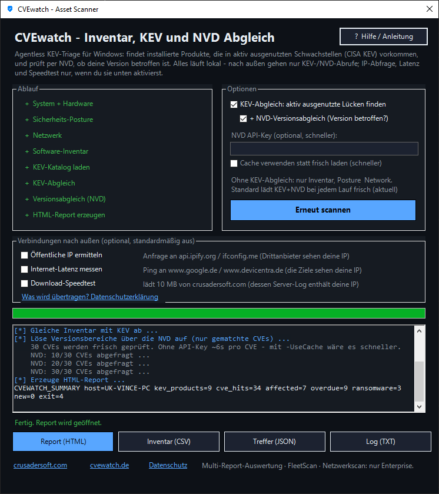

# CVEwatch

> Open Security Platform for Windows Asset Discovery, Security Posture Assessment and Vulnerability Intelligence.

CVEwatch helps identify security risks on Windows systems by combining:

- Asset Discovery
- Software Inventory
- Security Posture Analysis
- CISA KEV Intelligence
- NVD Version Validation
- Executive Security Reporting

The Community Edition is completely free and open source.

---

## Why CVEwatch?

Most vulnerability scanners either generate thousands of findings or require cloud-based inventory collection.

CVEwatch takes a different approach:

- Privacy-first
- Local processing by default
- Focus on actively exploited vulnerabilities
- Human-readable reports
- Clear prioritization
- Management-friendly summaries

The goal is simple:

**Make security risks understandable and actionable.**

---

## Screenshot



---

# Features

## Asset Discovery

Automatically collects:

- Operating System
- Hardware Information
- BIOS Information
- CPU
- GPU
- Memory
- Storage Devices
- Network Configuration
- Security-Relevant System Information

---

## Software Inventory

Discovers software from:

- Registry
- Winget
- AppX Packages
- Running Processes
- Services
- Drivers

Providing a comprehensive device inventory for security analysis.

---

## Security Posture Analysis

Checks important security controls including:

- Patch Status
- OS Support Status
- Windows Defender
- Firewall Configuration
- Secure Boot
- TPM
- BitLocker
- SMBv1
- RDP
- LSA Protection
- VBS
- HVCI
- ASR Configuration

---

## CISA KEV Matching

CVEwatch downloads the official
**Known Exploited Vulnerabilities (KEV) Catalog** from CISA.

Installed products are matched against vulnerabilities known to be actively exploited in real-world attacks.

This helps prioritize the vulnerabilities that matter most.

---

## NVD Version Validation

A KEV hit does not automatically mean the installed version is vulnerable.

CVEwatch can additionally:

- Retrieve vulnerability details from NIST NVD
- Analyze affected version ranges
- Compare installed versions against affected versions

Results are categorized as:

- Affected
- Version Unknown
- Likely Patched

---

## Executive Security Summary

Every report includes a management-focused overview:

- Critical Findings
- High-Risk Findings
- Prioritized Actions
- Estimated Remediation Effort
- Security Posture Summary

Designed for administrators, consultants and decision makers.

---

## Report Generation

CVEwatch automatically creates:

- HTML Reports
- CSV Inventories
- JSON Findings
- Log Files
- Executive Summaries

---

# Privacy

Privacy is a core principle of CVEwatch.

By default:

✅ Inventory data remains local

✅ No software inventory is uploaded

✅ No usernames are transmitted

✅ No hardware information is transmitted

---

## Default External Connections

Only the following sources are contacted:

### CISA

Download of the KEV Catalog.

### NIST NVD

Retrieval of CVE details.

Only CVE identifiers are requested.
No device inventory is transmitted.

---

## Optional External Checks

Disabled by default.

### Public IP Lookup

```powershell
-PublicIP
```

### Internet Latency Test

```powershell
-Latency
```

### Download Speed Test

```powershell
-SpeedTest
```

### Enable All External Tests

```powershell
-External
```

---

# Installation

```powershell
git clone https://github.com/CrusaderBoy/CVEwatch.git
cd CVEwatch
```

---

# Usage

Standard Scan:

```powershell
powershell -ExecutionPolicy Bypass -File .\CVEwatchSCANme.ps1
```

GUI Mode:

```powershell
powershell -ExecutionPolicy Bypass -File .\CVEwatchSCANme.ps1 -Gui
```

---

# Community vs Enterprise

| Feature | Community | Enterprise |
|----------|----------|----------|
| Asset Discovery | ✅ | ✅ |
| Security Posture Assessment | ✅ | ✅ |
| KEV Matching | ✅ | ✅ |
| NVD Version Validation | ✅ | ✅ |
| HTML Reporting | ✅ | ✅ |
| Fleet Analytics | ❌ | ✅ |
| Central Dashboard | ❌ | ✅ |
| Historical Tracking | ❌ | ✅ |
| Multi-Tenant Support | ❌ | ✅ |
| Network Discovery | ❌ | ✅ |
| Network Scanning | ❌ | ✅ |
| Dedicated CVEwatch Instances | ❌ | ✅ |

---

# Enterprise Edition

CVEwatch Enterprise extends the platform with:

- Fleet Visibility
- Central Reporting
- Historical Security Tracking
- Multi-System Analysis
- Network Discovery
- Network Scanning
- Multi-Tenant Deployments
- Dedicated CVEwatch Instances

More information:

https://cvewatch.de
x@crusadersoft.com

---

# Limitations

Transparency matters.

Please note:

- CISA KEV does not provide machine-readable version ranges.
- Initial matching is based on product and vendor information.
- Version validation relies on published NVD data.
- Vendor version schemes are not always consistent.
- A KEV match does not automatically mean a system is vulnerable.
- Critical findings should always be reviewed manually.

---

# License

Licensed under the Apache License 2.0.

See LICENSE for details.

---

# Disclaimer

CVEwatch helps identify security risks and exposure.

It is not a replacement for professional security assessments, vulnerability management programs or penetration testing.

Use at your own risk.

---

# Website

https://cvewatch.de
https://crusadersoft.com

---
# Thank you

Please feel free to contact me anytime. Regards Chris (06.11.26 - 17:02 +1)
