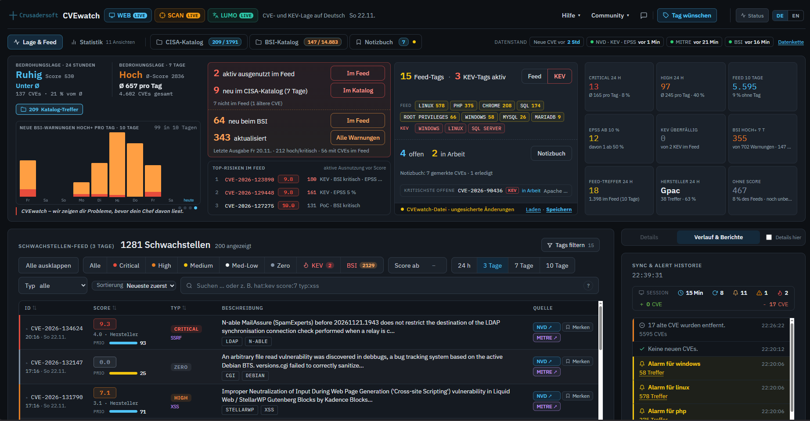

# CVEwatch WEB

<sub>[← zurück zur README](../README.md) · [English](WEB_en.md)</sub>

**Die CVE- und KEV-Lage auf Deutsch.** Kein Setup, kein Account, keine Telemetrie.

🌐 [cvewatch.de](https://cvewatch.de) · 💬 [Discord](https://discord.gg/jKXJYyum3P) · ✉️ [support@crusadersoft.com](mailto:support@crusadersoft.com)

> *CVEwatch – bevor aus einer CVE ein Incident wird.*



---

## Was ist CVEwatch?

CVEwatch zeigt alle neuen Schwachstellen der letzten 10 Tage in einem Live-Dashboard. Es führt fünf öffentliche Quellen zusammen und bewertet jede CVE nach Schwere und tatsächlicher Ausnutzung. Oben im Dashboard steht immer, was davon heute wirklich wichtig ist.

Entwickelt von **Crusadersoft** in Deutschland, betrieben auf eigener Infrastruktur.

## Auf einen Blick

| | |
|---|---|
| 🎯 **Top-Risiko** | Die gefährlichste CVE im Feed, gewichtet nach aktiver Ausnutzung, BSI-Einstufung, Score und EPSS |
| 📊 **Lage-Card** | Threat-Level für 24 h und 7 Tage, aktiv ausgenutzte CVEs, neue BSI-Warnungen, neun Kennzahlen |
| 🔥 **KEV** | Abgleich mit dem Katalog der CISA, inklusive Ransomware-Kennzeichnung und Handlungsempfehlung |
| 🇩🇪 **BSI** | Deutsche Einordnung des BSI CERT-Bund (WID) mit Einstufung und Angriffsbeschreibung |
| 🧾 **CVE-Programm** | Datensatz des Herstellers direkt von MITRE: Score, betroffene Produkte, CWE, Einschätzung der CISA (SSVC) |
| 🔔 **Alarme** | Eigene Feed-Tags plus Alarme, die immer kommen: neu aktiv ausgenutzt, neue BSI-Warnung ab „hoch“, KEV-Watchlist |
| 🗂️ **Filter** | Zeitraum, Schweregrad, KEV, BSI, Mindest-Score, Schwachstellentyp, Tags, Volltext – frei kombinierbar |
| 📓 **Notizbuch** | CVEs merken, Status und Notizen pflegen. Alles bleibt lokal und lässt sich als Datei sichern und wieder laden |
| 📄 **Reports** | 24-Stunden- und 7-Tage-Report als PDF, CSV-Export, Discord-Broadcast |

---

## Schnellstart in 9 Schritten

1. **Ohne Anmeldung starten:** Passwortfeld leer lassen und **„Starte deine Watch“** klicken. Keine Registrierung, keine E-Mail.
2. **Lage einschätzen:**
   - Threat-Level, KEV- und BSI-Zeile und die Kacheln zeigen, wie angespannt die Lage ist.
   - Oben steht das Top-Risiko.
3. **Feed lesen:**

   | Element | Bedeutung |
   |---|---|
   | Score | Höchster Wert aus NVD, Hersteller und CISA |
   | Zeile darunter | CVSS-Version und Herkunft, z. B. `4.0 · Hersteller · MITRE` |
   | Pille **KEV** | Aktiv ausgenutzt (CISA) |
   | Pille **BSI** | Vom BSI eingeordnet, Farbe = Einstufung |
   | Pille **AKTIV** / **PoC** | Einschätzung der CISA: Angriffe beobachtet bzw. Angriffscode öffentlich |
   | Typ-Spalte | Schwachstellentyp, z. B. Injection, XSS, Speicherfehler |

   Aufklappen zeigt Beschreibung, CISA-Empfehlung, BSI-Kasten und den Datensatz des CVE-Programms.
4. **Feed-Tags setzen:**
   - Keywords wie `WINDOWS` oder `APACHE` hinterlegen.
   - Erkannt wird im Titel und in den Produktdaten des CVE-Programms. Tags, die nur dort stehen, sind gestrichelt umrandet.
5. **Alarme verstehen:**

   | Farbe | Auslöser |
   |---|---|
   | 🔴 Rot | Eine CVE im Feed wird neu als aktiv ausgenutzt gemeldet |
   | 🟠 Orange | Neue BSI-Warnung ab „hoch“ zu CVEs im Feed |
   | 🔵 Blau | Treffer deiner KEV-Watchlist |

6. **KEV-Watchlist setzen:** Im CISA-Katalog Hersteller und Produkte markieren. Neue Einträge dazu lösen den blauen Alarm aus.
7. **Filtern & suchen:** Alle Filter wirken zusammen, z. B. „24 h“ + „Critical“ + Typ „Injection“.
8. **Notizbuch führen:**
   - „Merken“ an jeder CVE, dazu Status und Notizen.
   - Sichern mit **„CVEwatch-Datei speichern“**. Die Datei enthält auch Feed- und KEV-Tags.
9. **Reports & Export:** 24h- oder 7-Tage-Report als PDF, Tabelle als CSV, Notizbuch als Text oder CSV.

---

## Datenkette – von der Quelle bis in den Browser

Die API läuft etwa alle 10 Minuten. Jede Quelle wird bei jedem Lauf geprüft, geladen wird nur, was sich wirklich geändert hat (event-driven).

```text
 ┌───────────────────────────── Quellen ─────────────────────────────┐
 │  CVE-Programm (MITRE)  ·  NVD (NIST)  ·  CISA KEV  ·  FIRST EPSS    │
 │                         BSI CERT-Bund WID                          │
 └─────────────────────────────────┬──────────────────────────────────┘
                                   ▼
        API-Ingest (PowerShell 7) · Score-Merge · Tag-Engine
                                   ▼
                           MariaDB (10-Tage-Fenster)
                                   ▼
                 Browser-Dashboard  ·  Discord-Broadcast
```

| # | Schritt | Quelle | Was passiert |
|---|---|---|---|
| 1 | **API-Ingest** | PowerShell 7 | Läuft im ~10-Minuten-Takt. Jede Quelle wird geprüft, geladen wird nur bei Änderungen. Ein stündlicher Vollabgleich fängt auf, was durchgerutscht ist |
| 2 | **CVE-Liste** | MITRE · CVE-Programm (cvelistV5) | Der Ursprung jeder CVE: Datensatz des Herstellers mit eigenem Score (oft CVSS 4.0), betroffenen Produkten und Versionen, CWE. Dazu die Ergänzungen der CISA mit SSVC-Einschätzung |
| 3 | **CVE** | NVD (NIST) | Veröffentlichung, Beschreibung, Referenzen und die Scores der NVD. Seit April 2026 bewertet die NIST nur noch ausgewählte CVEs selbst |
| 4 | **Score** | CVEwatch | Aus NVD, Hersteller und CISA gewinnt der **höchste** Score (CVSS 4.0/3.1/3.0). Version und Herkunft bleiben sichtbar. Daraus folgt die Severity-Klasse |
| 5 | **EPSS** | FIRST.org | Wahrscheinlichkeit einer Ausnutzung in den nächsten 30 Tagen, mit Percentile |
| 6 | **KEV** | CISA | Abgleich, ob die CVE nachweislich aktiv ausgenutzt wird, mit Ransomware-Kennzeichnung und Handlungsempfehlung |
| 7 | **BSI** | BSI CERT-Bund · WID (CSAF) | Deutsche Einordnung: Einstufung, Angriffsbeschreibung, betroffene Systeme. Wird unverändert übernommen |
| 8 | **Tags** | CVEwatch Tag-Engine | Erkennt Hersteller, Produkte und Betriebssysteme anhand gepflegter Listen in der Datenbank, aus dem Titel *und* aus den Produktdaten des CVE-Programms |
| 9 | **Datenbank** | MariaDB | Speichert den angereicherten Datensatz. Die Web-Version hält ein rollierendes 10-Tage-Fenster |
| 10 | **Ausgabe** | Browser + Discord | Live-Dashboard mit Feed, Karten, Alarmen und Notizbuch. Parallel geht der Broadcast nach Discord |

### Gut zu wissen

- **Mehrere Quellen, eine Bewertung:** Fällt eine Quelle aus, laufen die anderen weiter. Welcher Score gilt und woher er stammt, steht im Feed direkt unter dem Score.
- **Event-driven statt Intervall:** Leere Zeitfenster erzeugen keine Meldung. Verlauf und Broadcast bleiben frei von Rauschen.
- **KEV und BSI alarmieren immer:** Neu aktiv ausgenutzte Lücken und neue BSI-Warnungen ab „hoch“ meldet CVEwatch unabhängig von deinen Feed-Tags.
- **Uhrzeit im Feed:** Gezeigt wird die Veröffentlichung bei der NVD in deutscher Zeit. Bis eine CVE abrufbar ist und im Feed erscheint, vergehen oft einige Minuten bis etwa eine Stunde.

---

## Broadcast

Neue Funde landen event-driven im [Discord](https://discord.gg/jKXJYyum3P):

- `#cve-feed` für neue CVEs
- `#kev-alert` für aktiv ausgenutzte Lücken

Einfach beitreten und die Kanäle nicht stummschalten.

## Datenschutz

- **Kein Account, keine Telemetrie.**
- Feed-Tags, KEV-Tags und Notizbuch leben nur in deiner Browser-Session. Sichern kannst du sie lokal als CVEwatch-Datei.
- Der Server speichert keine personenbezogenen Einstellungen.

## Die CVEwatch-Familie

| | |
|---|---|
| **WEB** | Dieses Dashboard: kostenlos, im Browser, 10-Tage-Fenster |
| **SCAN** | AssetScan: lokales PowerShell-Tool, prüft Geräte gegen den KEV-Katalog und liefert Exit-Codes für Intune, RMM und CI |
| **LUMO** | Die CVEwatch-KI, lokal auf eigener VM – siehe unten |
| **Pro** | 31 Tage Übersicht, unbegrenzte Feed- und KEV-Tags, Discord-Badge, früher Zugang zu neuen Funktionen |
| **Enterprise** | Custom-Integration: CVEwatch wird gemeinsam mit dir an deine Umgebung angepasst und 2–4 Wochen feingetunt – deine Systeme, Tags und Watchlists, Reports und Alarmwege (z. B. SIEM, Ticketsystem, Teams, Slack, E-Mail) |

## LUMO – unsere KI für CVEs

LUMO ist die CVEwatch-KI. Sie läuft bereits im Community-Discord und übersetzt dort CVE-Beschreibungen und Handlungsempfehlungen.

- **Der Name:** LUMO durfte sich selbst einen Namen geben und hat diesen gewählt – aus dem Esperanto für „Licht“, als Symbol für Erkenntnis, Wärme und Orientierung.
- **DSGVO-konform:** LUMO läuft lokal auf einer eigenen VM – keine Daten an externe KI-Anbieter oder Cloud-Dienste.
- **Status:** Als Nächstes übersetzt LUMO den gesamten Feed. Danach kommen die Übersetzungen auch in CVEwatch WEB.

| Phase | Status | Aufgabe |
|---|---|---|
| 1 | ✅ Live | Übersetzt CVE-Beschreibungen und Handlungsempfehlungen |
| 2 | Geplant | Wertet Bedrohungsverhalten und CVEs aus und erstellt Berichte |
| 3 | Geplant | Erstellt eigene Handlungsempfehlungen |

## Quellen & Lizenzen

Die CVE-Daten stammen aus öffentlichen Quellen:

- [CVE-Programm / MITRE](https://www.cve.org)
- [NVD / NIST](https://nvd.nist.gov)
- [CISA KEV](https://www.cisa.gov/known-exploited-vulnerabilities-catalog)
- [FIRST EPSS](https://www.first.org/epss/)
- [BSI CERT-Bund WID](https://wid.cert-bund.de)

Zusammenführung, Bewertung, Tags und Darstellung übernimmt CVEwatch. Dieses Produkt nutzt Daten der NVD-API, ist aber nicht von der NVD empfohlen oder zertifiziert. Alle Angaben ohne Gewähr. Für die Bewertung der eigenen Systeme bleibt jeder Betreiber selbst verantwortlich.

---

<sub>© Crusadersoft · CVEwatch WEB · Digitale Souveränität, technisch ehrlich.</sub>
