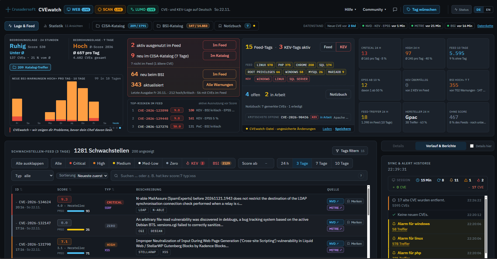

# CVEwatch WEB

<sub>[← back to README](../README.md) · [Deutsch](WEB.md)</sub>

**The CVE and KEV situation in German.** No setup, no account, no telemetry.

🌐 [cvewatch.de](https://cvewatch.de) · 💬 [Discord](https://discord.gg/jKXJYyum3P) · ✉️ [support@crusadersoft.com](mailto:support@crusadersoft.com)

> *CVEwatch – before a CVE becomes an incident.*



---

## What is CVEwatch WEB?

A live dashboard showing every new vulnerability of the last 10 days. It merges five public sources and rates each CVE by severity *and* real-world exploitation. The top of the dashboard always shows what actually matters today.

Built by **Crusadersoft** in Germany and run on its own infrastructure. The interface is available in German and English.

## At a glance

| | |
|---|---|
| 🎯 **Top risk** | The most dangerous CVE in the feed, weighted by active exploitation, BSI rating, score and EPSS |
| 📊 **Situation card** | Threat level for 24 h and 7 days, actively exploited CVEs, new BSI advisories, nine key figures |
| 🔥 **KEV** | Match against the CISA catalog, including ransomware use and CISA's required action |
| 🇩🇪 **BSI** | German assessment by BSI CERT-Bund (WID) with rating and attack description |
| 🧾 **CVE Program** | The vendor's record straight from MITRE: score, affected products, CWE, CISA's SSVC assessment |
| 🔔 **Alerts** | Your own feed tags. Some alerts always fire: newly exploited, new BSI advisory rated "high" or above, KEV watchlist hit |
| 🗂️ **Filters** | Time range, severity, KEV, BSI, minimum score, weakness type, tags, full text – freely combinable |
| 📓 **Notebook** | Track CVEs with status and notes. Everything stays local and can be saved to and restored from a file |
| 📄 **Reports** | 24-hour and 7-day report as PDF, CSV export, Discord broadcast |

---

## Quick start in 9 steps

1. **Start without signing in:** leave the password field empty and click **"Starte deine Watch"**. No registration, no e-mail.
2. **Assess the situation:**
   - The threat level, the KEV and BSI rows and the tiles show how tense things are.
   - The top risk sits in the status bar.
3. **Read the feed:**

   | Element | Meaning |
   |---|---|
   | Score | Highest value from NVD, vendor and CISA |
   | Line below | CVSS version and origin, e.g. `4.0 · Hersteller · MITRE` (vendor via MITRE) |
   | Pill **KEV** | Actively exploited (CISA) |
   | Pill **BSI** | Assessed by the BSI, color = rating |
   | Pill **AKTIV** / **PoC** | CISA assessment: attacks observed, or exploit code public |
   | Type column | Weakness type, e.g. Injection, XSS, memory error |

   Expanding a row shows the description, CISA's required action, the BSI box and the CVE Program record.
4. **Set feed tags:**
   - Store keywords such as `WINDOWS` or `APACHE`.
   - Tags are detected in the title and in the product data of the CVE Program. Tags that only appear in the product data have a dashed border.
5. **Understand the alerts:**

   | Color | Trigger |
   |---|---|
   | 🔴 Red | A CVE in the feed is newly reported as actively exploited |
   | 🟠 Orange | New BSI advisory rated "high" or above for CVEs in the feed |
   | 🔵 Blue | Hit on your KEV watchlist |

6. **Set up a KEV watchlist:** mark vendors and products in the CISA catalog. New entries for them trigger the blue alert.
7. **Filter & search:** all filters work together, e.g. "24 h" + "Critical" + type "Injection".
8. **Keep a notebook:**
   - Click "Merken" on any CVE, then add a status and notes.
   - Back it up with **"CVEwatch-Datei speichern"**. The file also holds your feed and KEV tags.
9. **Reports & export:** 24-hour or 7-day report as PDF, the table as CSV, the notebook as text or CSV.

---

## Data chain – from source to browser

The API runs about every 10 minutes. Every source is checked on each run, but only real changes are loaded (event-driven).

```text
 ┌───────────────────────────── Sources ─────────────────────────────┐
 │  CVE Program (MITRE)  ·  NVD (NIST)  ·  CISA KEV  ·  FIRST EPSS     │
 │                         BSI CERT-Bund WID                          │
 └─────────────────────────────────┬──────────────────────────────────┘
                                   ▼
         API ingest (PowerShell 7) · score merge · tag engine
                                   ▼
                          MariaDB (10-day window)
                                   ▼
                 Browser dashboard  ·  Discord broadcast
```

| # | Step | Source | What happens |
|---|---|---|---|
| 1 | **API ingest** | PowerShell 7 | Runs every ~10 minutes. Every source is checked, data is loaded only when it changes. An hourly full sync catches anything that slipped through |
| 2 | **CVE list** | MITRE · CVE Program (cvelistV5) | The origin of every CVE: the vendor's record with its own score (often CVSS 4.0), affected products and versions, CWE. Plus CISA's additions with the SSVC assessment |
| 3 | **CVE** | NVD (NIST) | Publication, description, references and the scores the NVD delivers. Since April 2026 NIST only rates selected CVEs itself |
| 4 | **Score** | CVEwatch | The **highest** score from NVD, vendor and CISA wins (CVSS 4.0/3.1/3.0). Version and origin stay visible, and the severity class follows from it |
| 5 | **EPSS** | FIRST.org | Probability of exploitation in the next 30 days, with percentile |
| 6 | **KEV** | CISA | Checks whether the CVE is known to be actively exploited, with ransomware flag and required action |
| 7 | **BSI** | BSI CERT-Bund · WID (CSAF) | German assessment: rating, attack description, affected systems. Taken over unchanged |
| 8 | **Tags** | CVEwatch tag engine | Detects vendors, products and operating systems from curated lists in the database, using the title *and* the CVE Program's product data |
| 9 | **Database** | MariaDB | Stores the enriched record. The web version keeps a rolling 10-day window |
| 10 | **Output** | Browser + Discord | Live dashboard with feed, cards, alerts and notebook, broadcast to Discord in parallel |

### Good to know

- **Several sources, one rating:** if one source fails, the others keep running. Which score applies and where it comes from is shown right below the score in the feed.
- **Event-driven instead of fixed intervals:** empty time windows produce no message, so history and broadcast stay free of noise.
- **KEV and BSI always alert:** newly exploited flaws and new BSI advisories rated "high" or above are reported regardless of your feed tags.
- **Time in the feed:** the NVD publication time, shown in German time. It often takes a few minutes up to about an hour until a CVE is available and appears in the feed.

---

## Broadcast

New findings are posted event-driven to [Discord](https://discord.gg/jKXJYyum3P):

- `#cve-feed` for new CVEs
- `#kev-alert` for actively exploited flaws

Join and keep the channels unmuted.

## Privacy

- **No account, no telemetry.**
- Feed tags, KEV tags and the notebook live only in your browser session. You can save them locally as a CVEwatch file.
- The server stores no personal settings.

## The CVEwatch family

| | |
|---|---|
| **WEB** | This dashboard: free, in the browser, 10-day window |
| **SCAN** | Local PowerShell tool that checks devices against the KEV catalog and returns exit codes for Intune, RMM and CI ([README](../README.md#cvewatch-scan)) |
| **LUMO** | The CVEwatch AI, running locally on its own VM – see below |
| **Pro** | 31-day view, unlimited feed and KEV tags, Discord badge, early access to new features |
| **Enterprise** | Custom integration: CVEwatch is fitted to your environment and fine-tuned over 2–4 weeks – your systems, tags and watchlists, reports and alerting channels (e.g. SIEM, ticketing, Teams, Slack, e-mail) |

## LUMO – our AI for CVEs

LUMO is the CVEwatch AI. It already runs in the community Discord and translates CVE descriptions and remediation there.

- **The name:** LUMO was allowed to choose its own name and picked this one – Esperanto for "light", a symbol of insight, warmth and orientation.
- **GDPR-compliant:** LUMO runs locally on its own VM. No data goes to external AI providers or cloud services.
- **Status:** next, LUMO translates the entire feed. The translations will then appear in CVEwatch WEB as well.

| Phase | Status | Scope |
|---|---|---|
| 1 | ✅ Live | Translates CVE descriptions and remediation |
| 2 | Planned | Analyzes threat behavior and CVEs, creates reports |
| 3 | Planned | Writes its own remediation recommendations |

## Sources & licenses

The CVE data comes from public sources:

- [CVE Program / MITRE](https://www.cve.org)
- [NVD / NIST](https://nvd.nist.gov)
- [CISA KEV](https://www.cisa.gov/known-exploited-vulnerabilities-catalog)
- [FIRST EPSS](https://www.first.org/epss/)
- [BSI CERT-Bund WID](https://wid.cert-bund.de)

CVEwatch handles merging, rating, tagging and presentation. This product uses data from the NVD API but is not endorsed or certified by the NVD. All information without warranty. Every operator remains responsible for assessing their own systems.

---

<sub>© Crusadersoft · CVEwatch WEB · Digital sovereignty, technically honest.</sub>
